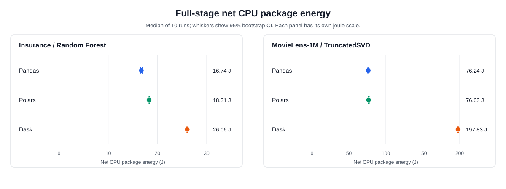

# A laptop replication of DataFrame energy on Insurance and MovieLens-1M

Le Tuan Nguyen · Computer Science, University at Buffalo · 25 October 2026

[Repository](https://github.com/Nguyen-Le-Tuan/Comparing-3-python-DataFrame-lib)

## 1. What I replicated

I tested two results from [Kumar, Imran, and Kosar's GREENS '26 paper](https://arxiv.org/pdf/2511.08644). For Insurance + Random Forest (C1; Table 1, Section 4.1), Pandas and Polars use nearly equal CPU energy, while Dask uses more and has the longest runtime (1.027 s versus 0.817 and 0.815 s). For MovieLens-1M + collaborative filtering (C2; Table 1, Section 4.3), the energy order is Polars < Pandas < Dask.

This is a small-scale **replication**, not an exact reproduction: I used different hardware, software, and model choices. C1 is partially reproduced: Dask uses more energy and runs longest, but Pandas and Polars differ clearly. For C2, Dask is highest, while Pandas and Polars have no clear energy difference—a pattern outside my pre-measurement categories. I compare directions and relative gaps, not absolute joules.

## 2. Setup and differences from the paper

My Intel i5-12500H laptop has 16 threads and 16 GB RAM; it ran Ubuntu 26.04.1, Python 3.12.14, Pandas 3.0.6, Polars 2.0.0, and Dask 2026.8.0. The paper used a 32-thread workstation, 128 GB RAM, and 2022-era libraries. My Insurance file has 1,338 rows versus its reported 1,000; ML-1M has 1,000,209 ratings. The paper mentions Polars Parquet copies “where applicable” but does not name the datasets; all my backends read text inputs and produced matching checksums. I used a 100-tree Random Forest with an 80/20 split and a 50-component TruncatedSVD, as specified in [my protocol](../PROTOCOL.md).

The [full session](../results/raw/full-20261025-135703-JICxLk/) covered 12 configurations (three libraries × two datasets × two stages), with 12 warm-ups and 120 measured runs: ten per configuration, fresh processes, randomized order, and 40-second pauses. The runner recorded AC power, a balanced profile, and disabled Wi-Fi; I closed other apps. `perf stat` supplied package energy and runtime. Net energy = package joules − 5.139437 W × runtime, using this session's idle baseline. The paper summed core and DRAM energy. Its run-count description conflicts: Section 3.2.1 lists a warm-up, five monitored runs, then a mean of four runs. Elsewhere it says trimmed mean and 95% CI across five runs, but Table 1 shows no CIs. I cannot tell which summary produced that table.

I report median, IQR, and 10% trimmed mean. Median intervals use 10,000 bootstrap resamples (seed 42); non-overlap is the decision rule. Validation passed (0.38% sleep-test error; 1.854 doubled-loop ratio); the largest energy CV was 1.50%, below the 10% stop threshold. Protocol Sections 8–9 were committed before measurement in `4badf06`, but the `FROZEN` status was set afterward in `5881ae5`.

## 3. Results

I compare the `full` stage with the paper's end-to-end results. Table 1 gives medians from ten runs per configuration. These are net CPU *package* joules, not the paper's core-plus-DRAM joules.

| Dataset | Library | Net energy, median [95% CI] (J) | Runtime, median [95% CI] (s) | Data/full energy share |
| --- | --- | ---: | ---: | ---: |
| Insurance | Pandas | 16.736 [16.615, 16.910] | 0.897 [0.896, 0.899] | 24.5% |
| Insurance | Polars | 18.309 [18.132, 18.377] | 0.982 [0.977, 0.986] | 14.3% |
| Insurance | Dask | 26.061 [25.996, 26.118] | 1.405 [1.403, 1.414] | 59.1% |
| ML-1M | Pandas | 76.238 [75.702, 76.723] | 3.744 [3.733, 3.752] | 64.5% |
| ML-1M | Polars | 76.632 [76.419, 77.423] | 2.381 [2.376, 2.405] | 60.5% |
| ML-1M | Dask | 197.827 [196.951, 198.682] | 10.031 [10.006, 10.049] | 87.9% |

*Table 1. Full-stage results. Share = data-stage median / full-stage median from separate runs, not a directly metered phase. Source: [`summary.csv`](../results/analysis/summary.csv).*

*Figure 1. Net package energy with 95% bootstrap intervals; scales differ by dataset.*

### 3.1 C1: Insurance + Random Forest

The paper reports Pandas and Polars at 146.760 and 146.776 J, with Dask about 14% higher. Here Polars uses 9.4% more than Pandas, and Dask 55.7% more. Their energy intervals do not overlap; Dask also runs longest. C1 is **partially reproduced** under Protocol Section 9: Dask's disadvantage holds, but the expected Pandas–Polars tie does not.

### 3.2 C2: MovieLens-1M + TruncatedSVD

The paper reports Polars < Pandas < Dask (1,437.00, 3,328.32, 3,748.08 J). My medians are Pandas 76.238 J, Polars 76.632 J, Dask 197.827 J. The Pandas–Polars gap is 0.52%, but their intervals overlap: **no clear difference**. Dask is clearly higher.

I chose reading **D**: **not covered by the pre-registered criteria**. “Reproduced” requires Polars clearly below Pandas; “Partially reproduced” requires Polars lowest and Pandas–Dask unclear or reversed, whereas Pandas is clearly lower than Dask. “Not reproduced” from a 0.52% point-median reversal would ignore the overlapping intervals. I kept the rule and logged the gap in Protocol Section 13. Polars runs faster than Pandas (2.381 versus 3.744 s), but C2 judges energy.

### 3.3 Not tested

I did not run SVR, XGBoost, or TabNet on Insurance; NCF on ML-1M; or the COCO models. I measured neither GPU nor DRAM energy: these pipelines use the CPU, and this laptop has no DRAM RAPL counter. Omitted cases receive no verdict.

### 3.4 My pre-registered hypothesis

I predicted Pandas would perform best on Insurance and Polars on ML-1M (Protocol Section 1). Pandas has the lowest Insurance energy and runtime. Polars has the shortest ML-1M runtime, but no clear energy advantage over Pandas. My phrase “perform the best” did not specify a metric, so I assess energy and time separately.

## 4. Mismatches with the paper

On Insurance, Dask's energy gap from Pandas is 55.7%, versus about 14% in the paper; Pandas and Polars also separate rather than remain nearly equal. The paper's large Polars energy advantage on ML-1M is absent, although Polars remains faster.

Dask's data-stage share is 59.1% on Insurance and 87.9% on ML-1M, higher than the others. This suggests a follow-up on data processing, not proof that scheduling caused the gap: `data` and `full` were separate runs.

Possible tests: rerun with older libraries, vary row counts, compare Polars text and Parquet inputs, pin CPU cores, and measure on hardware with core and DRAM counters. These would probe version effects, fixed overhead, input format, scheduling, and energy domain. The paper does not say whether Insurance or ML-1M used Parquet; none of these tests has been run.

## 5. Limitations

Package energy includes activity outside Python; idle subtraction cannot remove it all. I recorded temperature but did not measure throttling. Section 2's differences prevent direct comparison of absolute joules.

Ten runs per configuration describe this laptop under the recorded conditions, not other machines. Exact statistical conventions were set after measurement and logged in Protocol Section 13. Overlapping intervals mean “no clear difference” under my rule, not equal energy.

The C2 categories omit the observed pattern; reading D avoids forcing a verdict. I cannot infer outcomes for untested models or other hardware.

## 6. Next experiment

I would test whether Dask's data-stage cost is mostly fixed overhead. I would repeat Insurance rows to sizes 1,338, 13,380, and 133,800, keeping columns and preprocessing fixed. A new session would use its own idle baseline, randomized order, fresh processes, one warm-up, and ten measured runs per configuration. A shrinking Dask/Pandas energy ratio would support fixed overhead; a stable or growing ratio would weaken it. This remains a proposed experiment to discuss with the authors.

## 7. Reproducibility and use of AI

The full run used code commit `4badf06`. Its [raw session](../results/raw/full-20261025-135703-JICxLk/) retains the schedule, all warm-ups and measured runs, the session-specific idle baseline, system-state records, and [input SHA-256 values](../results/raw/full-20261025-135703-JICxLk/input_sha256.txt). The [protocol](../PROTOCOL.md), [locked dependencies](../requirements.lock), measurement runner, and analysis script are in the repository. The [README](../README.md) and [data download helper](../scripts/download_data.sh) now document setup and pinned hashes. After a new measurement session, run `.venv/bin/python scripts/analyze_results.py <new-session-directory> --output-dir <new-empty-output-directory>`; omitting `--output-dir` would overwrite the committed `results/analysis` outputs. MovieLens data are not redistributed. A full clean-clone test is still pending.

I chose the claims, datasets, measurement constraints, and manual median check, and I operated the full benchmark. AI helped draft backend code, the analysis script, and this report's prose. AI laid out options for the C2 criterion gap; I chose reading D. The raw measurements came from my machine, not from AI.
