# A two-session laptop replication of DataFrame energy

Le Tuan Nguyen · Computer Science, University at Buffalo · 25 October to 16 November 2026

## 1. What I replicated and why

I wanted to see whether the energy rankings in [Kumar, Imran, and Kosar's paper](https://arxiv.org/html/2511.08644) would hold on a laptop with newer software. I tested six results from its Table 1: Random Forest, SVR, XGBoost, and TabNet on Insurance; collaborative filtering and neural collaborative filtering (NCF) on MovieLens-1M. In each pipeline, Pandas, Polars, or Dask prepared the data for the same downstream model.

I measured C1 and C2 in session 1 and C3 to C6 in session 2. This is a small-scale replication rather than an exact reproduction. My machine, some model choices, and the CPU energy counter differ from the paper's, so I compare library rankings and relative gaps; absolute joules are not comparable. The [protocol](../PROTOCOL.md) records the claims, hypotheses, choices, and decision rules.

## 2. Setup and differences from the paper

My laptop has an Intel i5-12500H, 16 GB of RAM, and an RTX 3050 Laptop GPU with 4 GB of VRAM. The paper used a 32-thread workstation with 128 GB of RAM and a 32 GB Tesla V100. My main environment used Python 3.12 and current DataFrame libraries; in session 2, I also measured a separate Python 3.8 environment with the paper's DataFrame versions. [Protocol Sections 0](../PROTOCOL.md#0-original-paper) and [10](../PROTOCOL.md#10-environment) list the exact hardware and versions, and the dependencies are locked in the repository.

My Insurance file has 1,338 rows, while the paper reports 1,000; MovieLens-1M has 1,000,209 ratings. The paper does not specify its model hyperparameters or its CF and NCF implementations, so I fixed my own before each session, as described in [Protocol Section 4](../PROTOCOL.md#4-pipeline-definition). These differences limit what a matching or mismatching result can mean.

I did not test the paper's COCO models or measure DRAM energy: the laptop has 4 GB of GPU memory and no DRAM RAPL counter. CPU package energy can also include activity outside the pipeline, even after idle subtraction. The results describe this laptop and these model choices, not other machines.

## 3. Methodology

All three backends did the same dataset-specific preparation, and their input and output checks matched. I measured both a `data` stage and a `full` stage that includes the model. The claims below use `full` because the paper's table reports end-to-end results. All Insurance models used the same 80/20 split; the [protocol](../PROTOCOL.md#4-pipeline-definition) gives the model and device settings.

| Session | Claims used in this report | Runs |
| --- | --- | --- |
| 1, 25 October | C1 Random Forest; C2 TruncatedSVD collaborative filtering | 12 configurations; 12 excluded warm-ups; 120 measured runs |
| 2, 16 November | C3 SVR; C4 XGBoost; C5 TabNet; C6 NCF | 30 configurations, including reference and older-stack runs; 30 excluded warm-ups; 300 measured runs |

The [session-1 runner](../scripts/run_measurements.sh) and [session-2 runner](../scripts/run_session2.sh) used fresh Python processes, a randomized order (seed 42), and 40-second pauses. Before runs, the scripts checked for AC power, the `balanced` power profile (`powerprofilesctl get`), Wi-Fi turned off (`nmcli radio wifi`), and no default network route (`ip route`). I closed avoidable apps manually for both sessions. The [session-1 notes](../results/raw/full-20261025-135703-JICxLk/session_notes.md) list them; for session 2, this is my recollection, without a separate app log. Neither runner closes apps or checks that they are closed.

In each session, five 30-second idle readings set a session-specific baseline. I subtracted idle power × runtime from the `perf stat` CPU package energy. In session 2, I also integrated NVML GPU board power and subtracted the GPU idle baseline for C6. For each configuration, I report the median of ten measured runs with a 95% bootstrap interval, and I count intervals that do not overlap as a clear difference.

The exact bootstrap and quartile conventions for session 1 were formalized after measurement, as recorded in the [analysis method](../results/analysis/method.md). I did not treat those later choices as pre-measurement rules.

The [measurement procedure](../PROTOCOL.md#7-procedure), [outcome criteria](../PROTOCOL.md#9-outcome-criteria), [session-1 analysis](../results/analysis/summary.csv), and [session-2 audit](../results/analysis/session2-20261116-012318-MJNiIT/reproducibility.md) give the checks and link to the raw data. Both sessions ran to completion. In session 2, all 300 measured runs succeeded, the checksums matched, and energy variation stayed below the 10% stop limit. A fresh local clone rebuilt both locked environments and regenerated the session-2 analysis byte for byte from data archives that had already been verified.

## 4. Results

Each plot shows measured `full`-stage medians, with 95% bootstrap intervals as whiskers, on its own joule scale. CPU values are net package energy, and C6 also shows net GPU board energy. The [session-1](../results/analysis/summary.csv) and [session-2](../results/analysis/session2-20261116-012318-MJNiIT/summary.csv) summaries give the exact values, runtimes, and intervals. The hypotheses come from [Protocol Section 1](../PROTOCOL.md#1-claims-and-hypotheses), and the verdicts follow [Protocol Section 9](../PROTOCOL.md#9-outcome-criteria).

### 4.1 Session 1

#### 4.1.1 C1: Insurance / Random Forest

> **Initial hypothesis:** I expected Pandas to perform best on the small Insurance dataset. I had not specified whether "best" meant energy or runtime.

Pandas used the least energy and had the shortest runtime. Dask used the most energy and ran longest, as in the paper, but my Pandas and Polars results differed clearly. **C1: partially reproduced.**

#### 4.1.2 C2: MovieLens-1M / TruncatedSVD

> **Initial hypothesis:** I expected Polars to perform best on the larger MovieLens-1M dataset. I had not specified a metric.

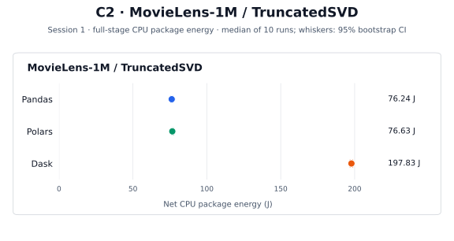

Polars ran fastest, but its energy interval overlapped with Pandas's, and Dask used clearly more energy than both. None of the C2 categories set before measurement covers this pattern, so I leave the verdict **uncategorized**.

### 4.2 Session 2

#### 4.2.1 C3: Insurance / SVR

> **Initial hypothesis (H3):** Pandas < Polars < Dask in net energy, with a clear difference between Pandas and Polars rather than the paper's near tie.

The results followed the predicted order. Dask was highest, as in the paper, but Pandas and Polars separated clearly instead of nearly tying. **C3: partially reproduced.**

#### 4.2.2 C4: Insurance / XGBoost

> **Initial hypothesis (H4):** Pandas < Polars < Dask in net energy, with a clear difference between Pandas and Polars rather than the paper's near tie.

XGBoost showed the same clear order as SVR: Dask was highest, and Pandas and Polars separated. **C4: partially reproduced.**

#### 4.2.3 C5: Insurance / TabNet

> **Initial hypothesis (H5):** Training would dominate, so the gaps between libraries would fall below the paper's 45%. Dask would be highest, and Polars would not be clearly lowest.

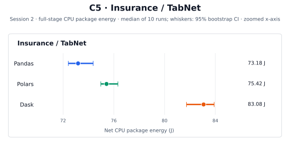

The gaps were smaller than the paper's, and Dask was highest. However, all three intervals separate in the order Pandas < Polars < Dask, which conflicts with the paper's Polars < Dask < Pandas. **C5: not reproduced.** The axis starts at 70 J so the intervals are visible.

#### 4.2.4 C6: MovieLens-1M / NCF

> **Initial hypothesis (H6):** Pandas and Polars would have no clear CPU energy difference, Dask would be clearly highest on CPU, and GPU energy would have no clear library difference.

**CPU package energy**

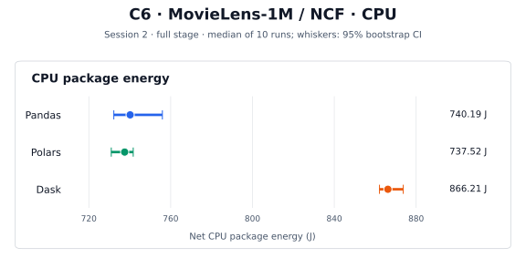

**GPU board energy**

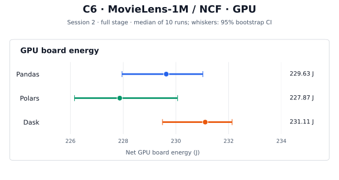

On CPU, the Pandas and Polars intervals overlap and Dask is clearly higher. **C6 CPU: partially reproduced.** On GPU, all three intervals overlap. **C6 GPU: not reproduced** under the declared rule, although overlapping intervals do not show that the libraries used equal energy.

## 5. How my results differ from the paper

Each pair sets my plot from Section 4 beside a redrawing of the paper's [Table 1 values](https://arxiv.org/html/2511.08644). Pandas is blue, Polars green, and Dask orange in every plot. Compare the order and the relative gaps. Positions and absolute joules are not comparable: each panel has its own scale, my CPU measure is idle-adjusted package energy while the paper sums core and RAM energy, and for C6 the GPUs also differ. Table 1 gives no intervals for individual rows, so the paper's plots show only point values.

### 5.1 C1: Random Forest

| My laptop | Paper |
| --- | --- |
|  | 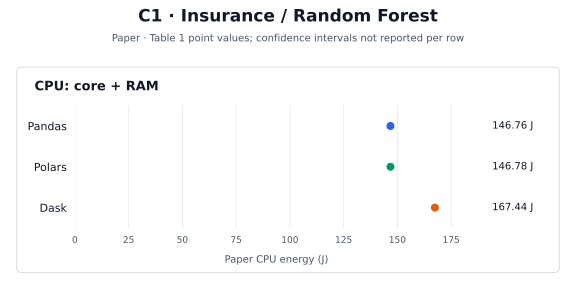 |

Dask is highest in both, but its gap above Pandas is 55.7% here and 14.1% in the paper. My Pandas and Polars intervals also separate, while the paper has the two nearly tied.

### 5.2 C2: Collaborative filtering

| My laptop | Paper |
| --- | --- |
|  | 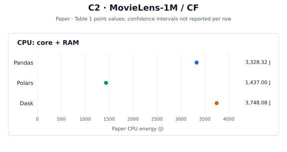 |

The paper shows a large Polars advantage over Pandas; I found no clear energy difference between them. Both put Dask highest.

### 5.3 C3: SVR

| My laptop | Paper |
| --- | --- |
|  | 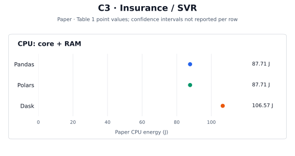 |

The paper's Pandas and Polars values are nearly identical, while mine separate clearly. Dask is highest in both.

### 5.4 C4: XGBoost

| My laptop | Paper |
| --- | --- |
|  | 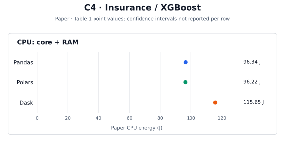 |

As with SVR, my Pandas and Polars intervals separate while the paper reports nearly equal values, and Dask is again highest.

### 5.5 C5: TabNet

| My laptop | Paper |
| --- | --- |
|  | 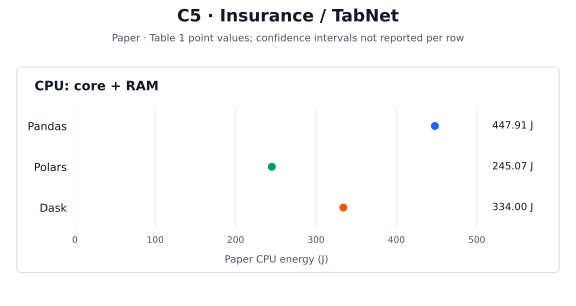 |

The order changes from Polars < Dask < Pandas in the paper to Pandas < Polars < Dask here, and my three values are much closer together. My axis is zoomed, while the paper's starts at zero.

### 5.6 C6: NCF

**CPU energy**

| My laptop | Paper |
| --- | --- |
|  | 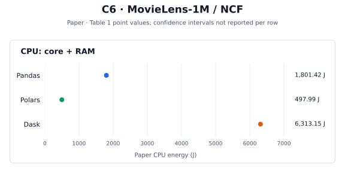 |

**GPU energy**

| My laptop | Paper |
| --- | --- |
|  | 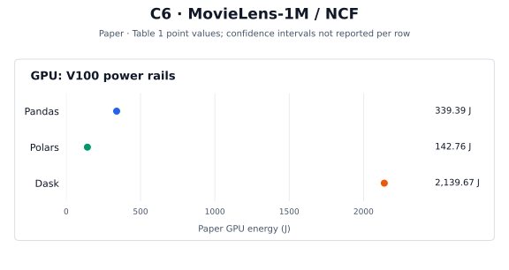 |

The paper orders both CPU and GPU energy Polars < Pandas < Dask. Here only Dask's higher CPU energy is clear: Pandas and Polars overlap on CPU, and all three libraries overlap on GPU. The CPU and GPU plots have separate joule scales.

## 6. AI use disclosure

I chose the claims, datasets, hypotheses, model constraints, and interpretation, and I ran the measurements on my laptop. AI assisted with the pipeline and analysis code, figure generation, and editing this report. I checked the outputs against the saved measurements and the paper's table; AI did not generate the measured results.
