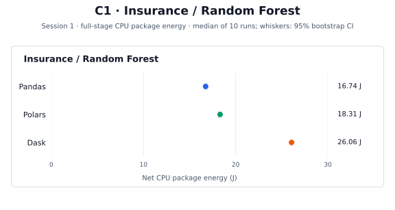
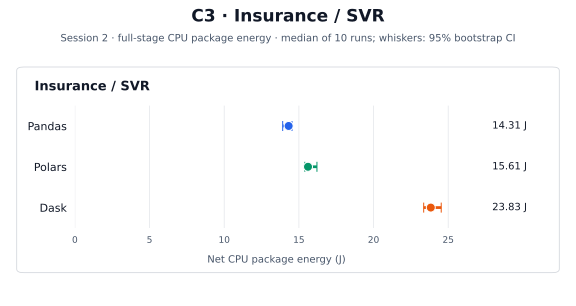
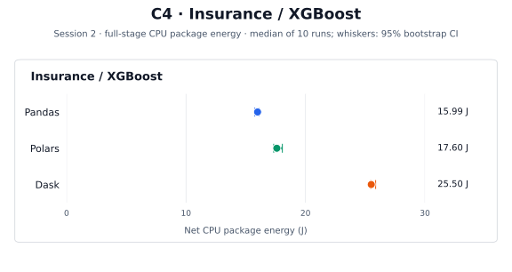
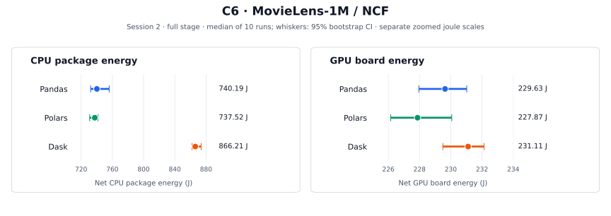

# A two-session laptop replication of DataFrame energy

Le Tuan Nguyen · Computer Science, University at Buffalo · 25 October–16 November 2026

## 1. What I replicated

Session 1 tested two results from [Kumar, Imran, and Kosar's GREENS '26 paper](https://arxiv.org/pdf/2511.08644). For Insurance + Random Forest (C1; Table 1, Section 4.1), Pandas and Polars use nearly equal CPU energy, while Dask uses more and has the longest runtime (1.027 s versus 0.817 and 0.815 s). For MovieLens-1M + collaborative filtering (C2; Table 1, Section 4.3), the energy order is Polars < Pandas < Dask. Session 2 adds SVR, XGBoost, TabNet, NCF and an older-software-stack comparison; its results appear in Section 8.

This is a small-scale replication; I used different hardware, software, and model choices. C1 is partially reproduced: Dask uses more energy and runs longest, but Pandas and Polars differ clearly. For C2, Dask is highest, while Pandas and Polars have no clear energy difference—a pattern outside my pre-measurement categories. I compare directions and relative gaps, not absolute joules.

## 2. Setup and differences from the paper

My Intel i5-12500H laptop has 16 threads and 16 GB RAM; it ran Ubuntu 26.04.1, Python 3.12.14, Pandas 3.0.6, Polars 2.0.0, and Dask 2026.8.0. The paper used a 32-thread workstation, 128 GB RAM, and libraries version in 2022. My Insurance file has 1,338 rows versus its reported 1,000; ML-1M has 1,000,209 ratings. The paper mentions Polars Parquet copies “where applicable” but does not name the datasets; all my backends read text inputs and produced matching checksums. I used a 100-tree Random Forest with an 80/20 split and a 50-component TruncatedSVD, as specified in [my protocol](../PROTOCOL.md).

The [full session](../results/raw/full-20261025-135703-JICxLk/) covered 12 configurations (three libraries × two datasets × two stages), with 12 warm-ups and 120 measured runs: ten per configuration, fresh processes, randomized order, and 40-second pauses. The runner recorded AC power, a balanced profile, and disabled Wi-Fi; I closed other apps. `perf stat` supplied package energy and runtime. Net energy = package joules − 5.139437 W × runtime, using this session's idle baseline. The paper summed core and DRAM energy. Its run-count description conflicts: Section 3.2.1 lists a warm-up, five monitored runs, then a mean of four runs. Elsewhere it says trimmed mean and 95% CI across five runs, but Table 1 shows no CIs. I cannot tell which summary produced that table.

I report median, IQR, and 10% trimmed mean. Median intervals use 10,000 bootstrap resamples (seed 42); non-overlap is the decision rule. Validation passed (0.38% sleep-test error; 1.854 doubled-loop ratio); the largest energy CV was 1.50%, below the 10% stop threshold. Protocol Sections 8–9 were committed before measurement in `4badf06`, but the `FROZEN` status was set afterward in `5881ae5`.

## 3. Results

I compare the `full` stage with the paper's end-to-end results. Table 1 gives medians from ten runs per configuration. These are net CPU *package* joules, not the paper's core-plus-DRAM joules.

| Dataset | Library | Net energy, median [95% CI] (J) | Runtime, median [95% CI] (s) | Data/full energy share |
| --- | --- | ---: | ---: | ---: |
| Insurance | Pandas | 16.736 [16.615, 16.910] | 0.897 [0.896, 0.899] | 24.5% |
| Insurance | Polars | 18.309 [18.132, 18.377] | 0.982 [0.977, 0.986] | 14.3% |
| Insurance | Dask | 26.061 [25.996, 26.118] | 1.405 [1.403, 1.414] | 59.1% |
| ML-1M | Pandas | 76.238 [75.702, 76.723] | 3.744 [3.733, 3.752] | 64.5% |
| ML-1M | Polars | 76.632 [76.419, 77.423] | 2.381 [2.376, 2.405] | 60.5% |
| ML-1M | Dask | 197.827 [196.951, 198.682] | 10.031 [10.006, 10.049] | 87.9% |

*Table 1. Full-stage results. Share = data-stage median / full-stage median from separate runs, not a directly metered phase. Source: [`summary.csv`](../results/analysis/summary.csv).*

### 3.1 C1: Insurance + Random Forest

The paper reports Pandas and Polars at 146.760 and 146.776 J, with Dask about 14% higher. Here Polars uses 9.4% more than Pandas, and Dask 55.7% more. Their energy intervals do not overlap; Dask also runs longest. C1 is **partially reproduced** under Protocol Section 9: Dask's disadvantage holds, but the expected Pandas–Polars tie does not.

*Figure 1. C1, session 1. Dots are measured full-stage medians; whiskers are 95% bootstrap intervals. Source: [session-1 summary](../results/analysis/summary.csv).*

### 3.2 C2: MovieLens-1M + TruncatedSVD

The paper reports Polars < Pandas < Dask (1,437.00, 3,328.32, 3,748.08 J). My medians are Pandas 76.238 J, Polars 76.632 J, Dask 197.827 J. The Pandas–Polars gap is 0.52%, but their intervals overlap: **no clear difference**. Dask is clearly higher.

I chose reading **D**: **not covered by the pre-registered criteria**. “Reproduced” requires Polars clearly below Pandas; “Partially reproduced” requires Polars lowest and Pandas–Dask unclear or reversed, whereas Pandas is clearly lower than Dask. “Not reproduced” from a 0.52% point-median reversal would ignore the overlapping intervals. I kept the rule and logged the gap in Protocol Section 13. Polars runs faster than Pandas (2.381 versus 3.744 s), but C2 judges energy.

*Figure 2. C2, session 1. Pandas and Polars intervals overlap, although their whiskers are small on the full-range axis. Source: [session-1 summary](../results/analysis/summary.csv).*

### 3.3 Not tested in session 1

In session 1 I did not run SVR, XGBoost, or TabNet on Insurance; NCF on ML-1M; or the COCO models. I measured neither GPU nor DRAM energy in that session: those pipelines used the CPU, and this laptop has no DRAM RAPL counter. Session 2 covers the first four omitted models and NCF GPU energy (Section 8). The COCO models and DRAM energy remain untested.

### 3.4 My pre-registered hypothesis

I predicted Pandas would perform best on Insurance and Polars on ML-1M (Protocol Section 1). Pandas has the lowest Insurance energy and runtime. Polars has the shortest ML-1M runtime, but no clear energy advantage over Pandas. My phrase “perform the best” did not specify a metric, so I assess energy and time separately.

## 4. Mismatches with the paper

On Insurance, Dask's energy gap from Pandas is 55.7%, versus about 14% in the paper; Pandas and Polars also separate rather than remain nearly equal. The paper's large Polars energy advantage on ML-1M is absent, although Polars remains faster.

Dask's data-stage share is 59.1% on Insurance and 87.9% on ML-1M, higher than the others. This suggests a follow-up on data processing, not proof that scheduling caused the gap: `data` and `full` were separate runs.

Possible tests include varying row counts, comparing Polars text and Parquet inputs, pinning CPU cores, and measuring on hardware with core and DRAM counters. These would probe fixed overhead, input format, scheduling, and energy domain. The paper does not say whether Insurance or ML-1M used Parquet. A comparison with the paper's older Python and dataframe versions was subsequently run in session 2 (Section 8); the other tests remain proposals.

## 5. Limitations

Package energy includes activity outside Python; idle subtraction cannot remove it all. I recorded temperature but did not measure throttling. Section 2's differences prevent direct comparison of absolute joules.

Ten runs per configuration describe this laptop under the recorded conditions, not other machines. Exact statistical conventions were set after measurement and logged in Protocol Section 13. Overlapping intervals mean “no clear difference” under my rule, not equal energy.

The C2 categories omit the observed pattern; reading D avoids forcing a verdict. I cannot infer outcomes for the untested COCO models or other hardware.

## 6. Next experiment

I would test whether Dask's data-stage cost is mostly fixed overhead. I would repeat Insurance rows to sizes 1,338, 13,380, and 133,800, keeping columns and preprocessing fixed. A new session would use its own idle baseline, randomized order, fresh processes, one warm-up, and ten measured runs per configuration. A shrinking Dask/Pandas energy ratio would support fixed overhead; a stable or growing ratio would weaken it. This remains a proposed experiment to discuss with the authors.

## 7. Reproducibility and use of AI

The full run used code commit `4badf06`. Its [raw session](../results/raw/full-20261025-135703-JICxLk/) retains the schedule, all warm-ups and measured runs, the session-specific idle baseline, system-state records, and [input SHA-256 values](../results/raw/full-20261025-135703-JICxLk/input_sha256.txt). The [protocol](../PROTOCOL.md), [locked dependencies](../requirements.lock), measurement runner, and analysis script are in the repository. The [README](../README.md) and [data download helper](../scripts/download_data.sh) now document setup and pinned hashes. After a new session-1 measurement, run `.venv/bin/python scripts/analyze_results.py <new-session-directory> --output-dir <new-empty-output-directory>`; omitting `--output-dir` would overwrite the committed `results/analysis` outputs. MovieLens data are not redistributed. Section 8 records a fresh-clone check for session 2.

I chose the claims, datasets, measurement constraints, and manual median check, and I operated the full benchmark. AI helped draft backend code, the analysis script, and this report's prose. AI laid out options for the C2 criterion gap; I chose reading D. The raw measurements came from my machine, not from AI.

## 8. Session 2: new models and software-stack comparison

The [session-2 protocol](../PROTOCOL.md) was frozen before measurement at tag `session2-frozen-20261116` (commit `4e0e794`). The [raw session](../results/raw/full-20261116-012318-MJNiIT/) ran on 16 November 2026 from 01:23 to 05:44 EST: 30 configurations, 30 excluded warm-ups and 300 measured runs. All runs have `status=OK`. AC power, balanced profile, disabled Wi-Fi and no default route were recorded before and after; the runner checked these conditions before every baseline and run. The five-run CPU idle median was 5.524278 W; GPU idle power was 3.316746 W. CPU and GPU validation passed before the session. The [audit](../results/analysis/session2-20261116-012318-MJNiIT/reproducibility.md) found matching data checksums and deterministic model outputs; the largest net CPU energy CV was 4.261%, and the largest NCF net GPU energy CV was 1.071%, both below the 10% stop rule. Full results, runtime, IQR and 95% bootstrap intervals are in [`summary.csv`](../results/analysis/session2-20261116-012318-MJNiIT/summary.csv).

The following medians are net joules for the *full* stage, with one warm-up and ten measured runs per configuration. CPU values are package energy, not the paper's core-plus-DRAM measure. GPU values use NVML board power and are judged only for C6.

| Claim and energy domain | Pandas (J) | Polars (J) | Dask (J) | Protocol outcome |
| --- | ---: | ---: | ---: | --- |
| C3 SVR, CPU | 14.314 | 15.612 | 23.834 | Partially reproduced |
| C4 XGBoost, CPU | 15.988 | 17.600 | 25.504 | Partially reproduced |
| C5 TabNet, CPU | 73.181 | 75.424 | 83.075 | Not reproduced |
| C6 NCF, CPU | 740.193 | 737.516 | 866.208 | Partially reproduced |
| C6 NCF, GPU | 229.634 | 227.870 | 231.111 | Not reproduced |

Figures 3–6 plot the measured values in the table, not simulated data or the paper's absolute joules. Each figure has its own labeled joule scale; the C5 and C6 axes are zoomed to make the intervals visible.

### 8.1 C3: Insurance + SVR

Pandas is clearly below Polars, and Dask is clearly above both. The paper's Pandas–Polars similarity fails while Dask's disadvantage holds, so C3 is **partially reproduced**.

*Figure 3. C3, session 2 current stack: full-stage net CPU package energy. Source: [session-2 summary](../results/analysis/session2-20261116-012318-MJNiIT/summary.csv).*

### 8.2 C4: Insurance + XGBoost

The same clear order, Pandas < Polars < Dask, appears with XGBoost. The paper's Pandas–Polars tie fails, and its Dask disadvantage holds, so C4 is **partially reproduced**.

*Figure 4. C4, session 2 current stack: full-stage net CPU package energy. Source: [session-2 summary](../results/analysis/session2-20261116-012318-MJNiIT/summary.csv).*

### 8.3 C5: Insurance + TabNet

All three CPU intervals are separate in the order **Pandas < Polars < Dask**, reversing two of the paper's three pairwise relations (Polars < Dask < Pandas). C5 is **not reproduced**. The largest gap from the lowest median is 13.5%; the paper reported Polars 45.3% below Pandas.

*Figure 5. C5, session 2 current stack: full-stage net CPU package energy. The dot-plot axis begins at 70 J to show the intervals; it is not a bar chart. Source: [session-2 summary](../results/analysis/session2-20261116-012318-MJNiIT/summary.csv).*

### 8.4 C6: MovieLens-1M + NCF

On CPU, Pandas and Polars intervals overlap while Dask is clearly higher than both; the paper's Polars < Pandas relation is unclear, so C6 CPU is **partially reproduced**. On GPU, all three intervals overlap, so no paper-ordered pair is clear. Under the predeclared Section 9 rule, C6 GPU is **not reproduced**; this does not establish equal GPU energy.

*Figure 6. C6, session 2 current stack: full-stage net CPU package and GPU board energy. Panels use different zoomed joule scales; horizontal distances should not be compared across panels. Source: [session-2 summary](../results/analysis/session2-20261116-012318-MJNiIT/summary.csv).*

### 8.5 Data stage and reference runs

The NCF data-stage medians were 49.23 J (Pandas), 45.79 J (Polars) and 185.42 J (Dask), while the *full − data* training estimates were 690.97, 691.73 and 680.79 J. This pattern is consistent with the shared training code and a larger Dask preprocessing cost; the training estimate subtracts medians from separate processes and is not a directly metered training phase. The session-2 reference runs again put Dask highest for C1 and C2. C1 is partially reproduced; C2 again has overlapping Pandas–Polars energy intervals and the original session-1 criterion gap, which I do not force into an outcome.

### 8.6 Older-software-stack comparison

For the older-stack comparison, Insurance/Random Forest net CPU medians were **10.446 J Pandas, 11.159 J Polars and 14.169 J Dask** under Python 3.8 and the paper's dataframe versions. Pandas and Polars were still clearly different, and Dask remained clearly highest and slowest. Both the current and older stacks are therefore **Partially reproduced**, making the protocol's categorical version outcome **no change**. Descriptively, Dask's gap over Pandas shrank from 56.5% in the current stack to 35.6% in the older stack, closer to the paper's roughly 14% gap and consistent with hypothesis HV. Python and other dependencies changed together, so this cannot be assigned to a single dataframe package version.

### 8.7 Hypotheses and limits

The session-2 hypotheses in Protocol Section 1 predicted the observed directions for C3–C4, the smaller library gaps and Dask-high pattern for C5, the C6 CPU tie/Dask-high pattern, the unclear C6 GPU ranking, and the narrower older-stack Dask gap. These are checks of declared predictions, separate from whether the paper's claims were reproduced. A fresh local clone rebuilt both locked Python environments, re-extracted verified data archives, passed four-model and Python-3.8 smoke checks, and regenerated the two analysis files byte-for-byte. It reused previously verified ZIP archives rather than testing a new network download; details are in the [reproducibility audit](../results/analysis/session2-20261116-012318-MJNiIT/reproducibility.md). GPU energy is NVML board energy on an RTX 3050 Laptop, unlike the paper's V100; absolute joules are not comparable.
